  

  

  
  

<code>cd</code> → <a href="https://github.com/ali-maruf/pashro"><code>~/pashro</code></a> &nbsp;·&nbsp; <a href="https://github.com/ali-maruf/bachao"><code>~/bachao</code></a>

### `$ ./stack --icons`

  

### `$ ./telemetry --live`

  

  <code>[ connection terminated ]</code> &nbsp;·&nbsp; <code>exit 0</code>

